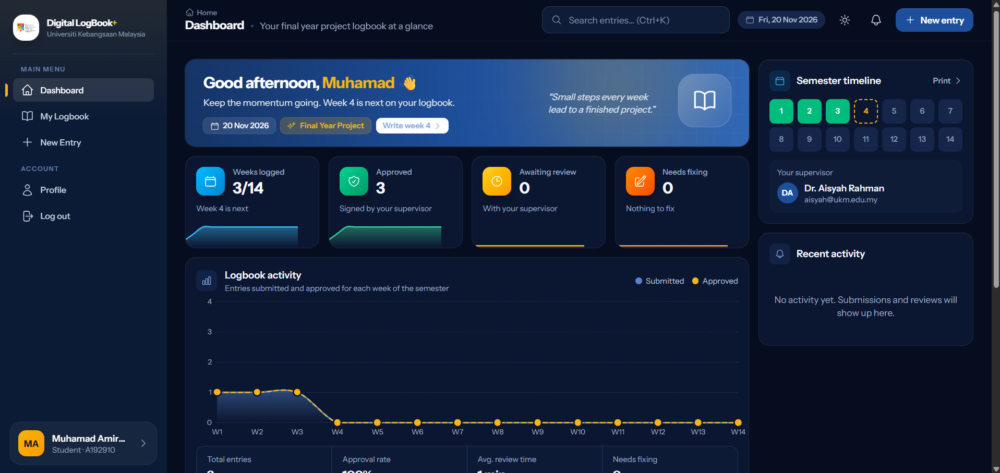

# Digital LogBook+

A weekly project logbook for UKM students and their supervisors, built with **Laravel 12**, Blade, and Tailwind CSS 4.



**Students**
- Write one signed entry per week: progress, current status, problems, next week's task, and the meeting with the supervisor (face to face, online or none; time, length, place).
- Attach evidence files (PDF, images, Word, PowerPoint, Excel; up to 5 per entry).
- See each week's due date. Late entries are tagged, and missing weeks show as overdue.
- Enter the project title and stage (FYP 1 / FYP 2) for the semester.

**Supervisors**
- Read each entry and either **approve and sign** it or **send it back** with a comment; the student fixes and resends it.
- See who is falling behind, and export their students' progress to Excel.

**FYP coordinator**
- Creates every account (there is no public sign-up), assigns students to supervisors, and imports many users at once from a CSV file.
- Sets up semesters (start date, days allowed to submit) and picks the current one.
- Sees every logbook, plus reports per supervisor and per student with Excel export.

**For everyone**
- Signed entries are locked, and every entry keeps a full change history (who changed what, and the old text).
- Notifications in the top bar and by email, a daily reminder on each week's due date, and a Monday summary for supervisors.
- The **full logbook** shows all 14 weeks with both signatures, ready to print or save as PDF.
- Forgot password by email, light/dark mode, and an English / Bahasa Melayu switch.

## Running it locally

You need PHP 8.2+, Composer, and Node.js 18+.

```bash
composer install
npm install
cp .env.example .env
php artisan key:generate
php artisan migrate --seed
npm run build
php artisan serve
```

Then open http://127.0.0.1:8000.

By default it uses SQLite (`database/database.sqlite`). To use MySQL instead, set `DB_CONNECTION=mysql` and the `DB_*` values in `.env`, then run `php artisan migrate --seed` again.

While you're changing the UI, run `npm run dev` alongside `php artisan serve` so CSS and JS reload as you edit.

### Demo accounts (from the seeder)

| Role        | Username      | Password   |
|-------------|---------------|------------|
| Coordinator | `coordinator` | `password` |
| Supervisor  | `dr.aisyah`   | `password` |
| Student     | `A192910`     | `password` |
| Student     | `A192911`     | `password` |

## Running it on a server

- **Email:** set the `MAIL_*` values in `.env` (for example the UKM SMTP server) and `MAIL_FROM_ADDRESS`. Locally, `MAIL_MAILER=log` writes emails to `storage/logs/laravel.log` instead of sending them.
- **Reminders:** add the Laravel scheduler to cron so `logbook:remind` runs every morning at 8:00:
  `* * * * * cd /path/to/app && php artisan schedule:run >> /dev/null 2>&1`
  You can also run `php artisan logbook:remind` by hand (`--digest` sends the supervisor summary on any day).
- **Files:** attachments are stored privately in `storage/app/private/attachments`; include that folder in backups.
- **First semester:** log in as the coordinator, open **Semesters**, and add the current semester before students start writing.

## Tests

```bash
php artisan test
```

## Project structure

| Path | What's in it |
|------|--------------|
| `app/Models/User.php` | Students and supervisors share one table, split by `role`. A student belongs to a supervisor through `supervisor_id`. |
| `app/Models/Logbook.php` | One weekly entry. `reviewed_at` is set when the supervisor signs it. |
| `app/Policies/LogbookPolicy.php` | Who can view, edit, delete, and review each entry. |
| `app/Http/Controllers/` | `LogbookController`, `StudentController` (supervisors only), `ProfileController`, `DashboardController`, `Auth/*` |
| `app/Http/Requests/` | Form validation, including the one-entry-per-week rule. |
| `resources/views/` | Blade views. The layouts and shared UI pieces are in `components/`. |
| `resources/js/app.js` | Signature pad, delete confirmations, and the mobile menu. |

## Changes from the original PHP version

- Passwords are hashed with bcrypt instead of unsalted SHA-1, and the student list no longer shows password hashes.
- Every form has CSRF protection, and deletes use `DELETE` requests instead of GET links.
- Access checks now happen on the server for every action. For example, a supervisor can only see and sign their own students' entries.
- Blade escapes every value it prints, which closes the XSS holes in the old pages.
- Anyone could self-register as a supervisor before, and that's still true. Students are still added by their supervisor.
